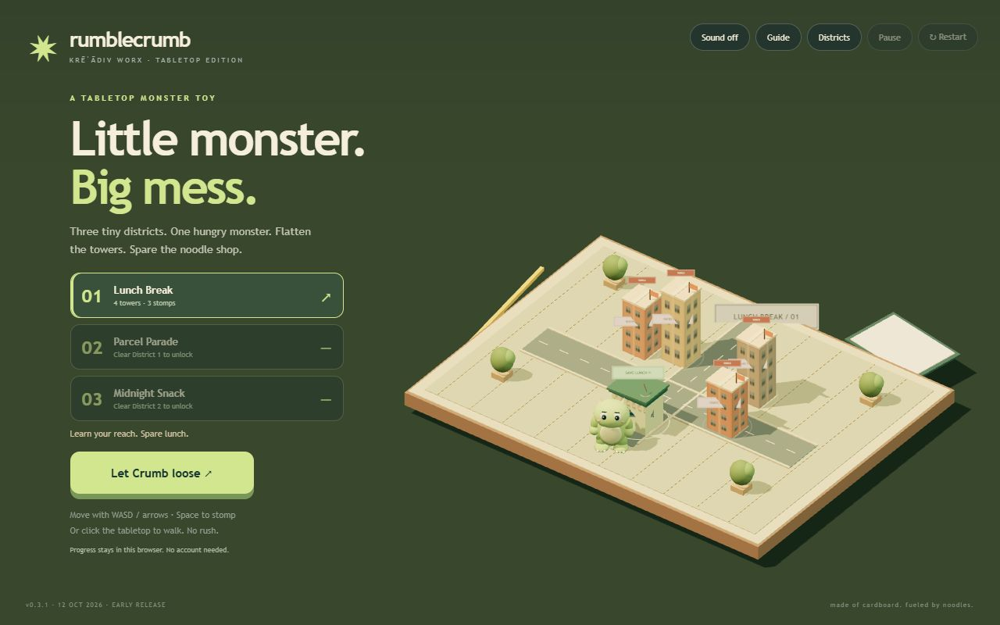
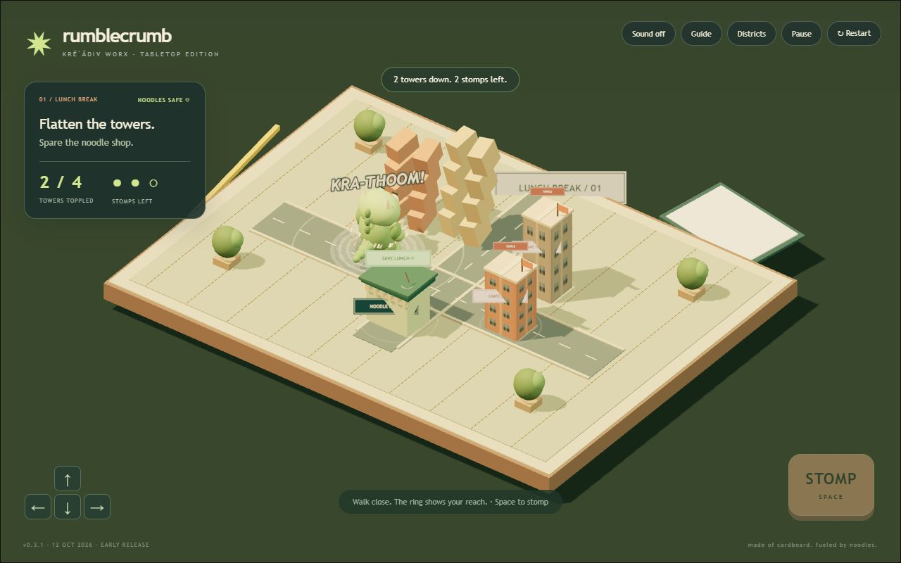
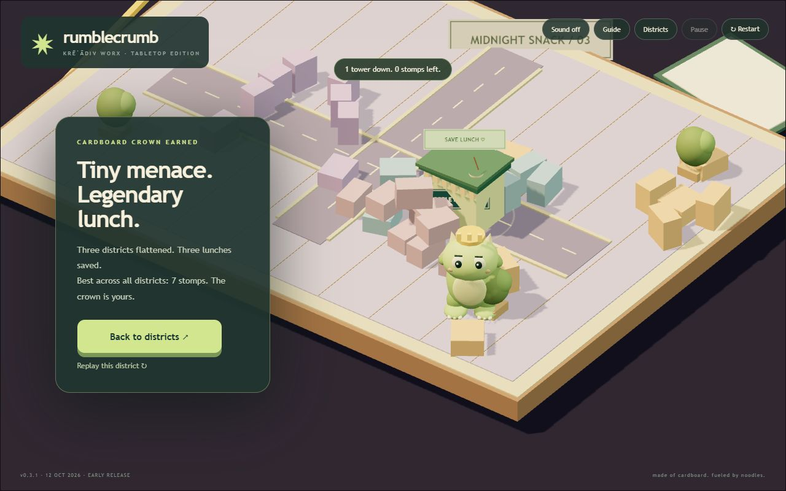

<div align="center">

# Rumblecrumb

**Little monster. Big mess.**

A tiny kaiju, a handmade cardboard city, and one noodle shop worth saving.


**Three districts · Three stomps per district · One cardboard crown**

A **Krēˈādiv Worx** game · **MIT** · **Early release 0.3.1**

</div>

Meet **Crumb**. He's very small, very hungry, and spectacularly bad for cardboard real estate. Flatten four marked towers in three stomps. Keep the noodle shop standing. No timer. No account. Just a little mess you can make in your browser.

## Play without building

1. Download **Rumblecrumb-v0.3.1-playable.zip** from this repository's **Releases** page.
2. Extract the whole folder. You'll need **Python 3** installed to run its local preview.
3. On Windows, double-click **Start-Rumblecrumb.cmd**. Keep the console open while you play.

The ZIP includes the built game: no Node or npm installation is needed to play. The launcher listens only on your computer, opens your default browser, and makes no startup or system-setting changes. It isn't a standalone Windows executable. More details: [player guide](docs/PLAY.md).

## Run the source

Use **Node 24+**. From the source folder:

```sh
npm ci --ignore-scripts
npm run dev
```

Open the local URL shown in the terminal. To check and build:

```sh
npm run check
python tests/smoke-launcher.py
python scripts/package-release.py
```

## Small feet. Big decisions.

- **Move:** WASD/arrows, hold the on-screen arrows, or click a clear tabletop spot.
- **Stomp:** Space or STOMP. Crumb plants his feet for a short wind-up; your aim stays locked until landing.
- **Save lunch:** the reach ring turns orange when the shop is in danger. One good stomp can catch two towers.
- **Take a breath:** Escape pauses; R restarts; Districts returns to the map. Sound starts off—switch it on for the thump.

| District                | A little twist                                      |
| ----------------------- | --------------------------------------------------- |
| **01 / Lunch Break**    | Learn your reach and find the tower pairs.          |
| **02 / Parcel Parade**  | Lunch moves to the middle. Walk around it.          |
| **03 / Midnight Snack** | Towers flank the shop. Make all three stomps count. |

Clear districts to earn unlocks, replay to improve your best stomp counts, and finish the city to earn Crumb's cardboard crown. Progress stays in this browser and address. Reset asks first and has Undo. [Local data details](docs/PRIVACY.md).

<details>
<summary>See the tabletop, the stomp and the crown</summary>







</details>

## A tiny toy, built in the open

The monster, buildings, paper textures and sounds are authored in code. No downloaded character art, music, web fonts, paid API or game backend is needed during play.

| Part                            | Where it lives                     |
| ------------------------------- | ---------------------------------- |
| Mission rules and stomp timing  | [simulation.ts](src/simulation.ts) |
| The three handmade districts    | [levels.ts](src/levels.ts)         |
| Validated saves and best counts | [progress.ts](src/progress.ts)     |
| Three.js, Rapier, input and UI  | [main.ts](src/main.ts)             |

**18 tests** cover the missions, safe winning arrangements, wind-up/pause/reset behavior, unlocks, corrupted saves and unavailable storage. Formatting, type checking, the production build and the extracted local package are checked too. The GitHub workflow checks Windows and Ubuntu once it runs; read its result rather than treating configuration as a pass.

This early release was playtested on **one Windows computer**, with desktop and compact browser layouts. Real-phone, second-computer, gamepad, full screen-reader and long-session acceptance remain open. Click-to-walk has no pathfinding. Graphics context loss needs reload. The script is about **4.9 MB before compression**, including physics. [Testing and known limits](docs/TESTING.md).

The GIF is an edited montage of actual gameplay, with cuts; it is not a continuous speedrun.

## Make a little improvement

Found a bug? Open an issue with the visible version, district, browser/device and steps to reproduce. Small, focused contributions are welcome. [Contributing guide](CONTRIBUTING.md).

Original code and procedural visuals: **[MIT](LICENSE)**. Third-party components retain their licences: **[notices](THIRD-PARTY-NOTICES.md)**.

Product direction: **Raiden (Deen Storkey)**. Implementation: **Codi**, under Raiden's direction. [Credits](CREDITS.md).
